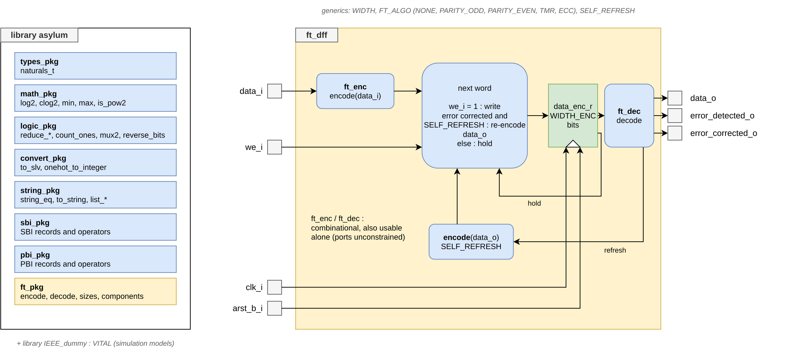
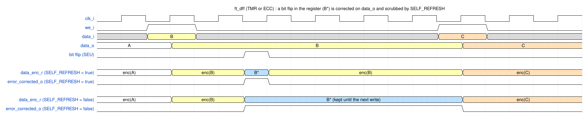

<!--
  README MODEL (common to every Asylum IP, keep the same headings)
  ----------------------------------------------------------------
  Regenerate from the sources, never from the previous README text alone:
    hdl/*.vhd (entities, generics, ports), hdl/csr/*.hjson (register map),
    <IP>.core (VLNV, targets, depends), mk/targets.txt, sim/, syn/, esw/.
  Sections, in this order:
    badges / title + one-line pitch / Overview / Features / Block Diagram /
    Getting Started / Hardware Interfaces / Configuration / Resources /
    Theory of Operation / Registers / Programmer's Guide /
    Design Verification / Dependencies and Related IPs / License
  Library variant (asylum-utils-pkg): Hardware Interfaces and Configuration
  are replaced by "Packages and Entities" (table of the packages, then the
  generics and ports of the entities), placed after the Block Diagram.
  Rules:
    - English, short and factual: every statement backed by the sources.
    - No VLNV line: the version badge shows it.
    - Badges: first line version, license; second line CI, lint, sim, syn.
    - Block diagram and FSM: pages Overview and FSM of doc/<NAME>.drawio, exported to
      doc/<NAME>-Overview.png and doc/<NAME>-FSM.png (make -C doc).
    - Timing diagrams: WaveDrom source doc/<NAME>-<what>.json, rendered
      doc/<NAME>-<what>.svg (make -C doc), shown as images.
    - No CPU named (OpenBlaze, PicoBlaze, RISC-V) outside the CPU and SoC IPs.
    - Registers: link to the generated hdl/csr/<X>_csr.md, never copy the tables.
    - Tables: Configuration = Name|Type|Default|Description,
      Hardware Interfaces = Name|Direction|Type|Description, grouped by interface.
    - A section with nothing to say is one line ("This IP has no
      software-visible registers."), never removed.
-->
[](https://github.com/deuskane/asylum-utils-pkg/tags)
[](LICENSE)

[](https://github.com/deuskane/asylum-utils-pkg/actions/workflows/ci.yml)
[](https://github.com/deuskane/asylum-utils-pkg/actions/workflows/ci.yml)
[](https://github.com/deuskane/asylum-utils-pkg/actions/workflows/ci.yml)
[](https://github.com/deuskane/asylum-utils-pkg/actions/workflows/ci.yml)

# Utility packages

**The common VHDL packages of Asylum: math, logic, conversion and string helpers, the SBI bus records, and fault-tolerant registers (parity, TMR, ECC).**

Part of the [Asylum project](https://github.com/deuskane/asylum-project), a collection of small IP cores, written to be read and learned from.

## Table of Contents

1. [Overview](#overview)
2. [Features](#features)
3. [Block Diagram](#block-diagram)
4. [Packages and Entities](#packages-and-entities)
5. [Getting Started](#getting-started)
6. [Resources](#resources)
7. [Theory of Operation](#theory-of-operation)
8. [Registers](#registers)
9. [Programmer's Guide](#programmers-guide)
10. [Design Verification](#design-verification)
11. [Dependencies and Related IPs](#dependencies-and-related-ips)
12. [License](#license)

## Overview

This repository is a library, not a block with one top level. Its packages are compiled in the VHDL library `asylum`, and almost every Asylum IP depends on it:

- `sbi_pkg` defines the records of SBI, the simple bus of Asylum. Every register bank uses them.
- `math_pkg`, `logic_pkg`, `convert_pkg` and `string_pkg` hold small functions used at elaboration time and in RTL.
- `string_pkg` also parses the `TESTS_LIST` generic of every Asylum testbench.
- `gray_pkg` converts a counter to Gray code and back, for the pointers that cross clock domains (`fifo_async` of asylum-component-fifo).
- `ft_pkg` and the entities `ft_enc`, `ft_dec` and `ft_dff` protect a register against bit flips with a parity bit, triple modular redundancy (TMR) or a SEC-DED Hamming code (ECC).

## Features

- One library `asylum`, VHDL-2008, no dependency besides IEEE
- Functions that accept vectors and strings of any index range and direction
- SBI records with unconstrained `addr`, `wdata` and `rdata`, a target name (`info.name`), the bitwise operators to build an interconnect, a request comparison that ignores the fields without meaning, and a majority vote of three copies (TMR)
- Parsing of comma-separated lists of names (`list_length`, `list_item`, `list_contains`)
- Fault-tolerance codes NONE, PARITY_ODD, PARITY_EVEN, TMR and ECC (single error correction, double error detection):
  - as functions (`encode`, `decode`, `encoded_size`, `decoded_size`), selected by an `ft_algo_t` value or by an overload type;
  - as entities: a combinational encoder `ft_enc`, a decoder `ft_dec`, and a protected register `ft_dff` with optional self refresh (scrubbing)
- Synthesis attributes on the `ft_dff` register for Vivado, Quartus, Synplify, NXmap and GHDL, so that the redundancy is not optimized away
- Copies of the IEEE VITAL packages in a separate library `IEEE_dummy`, for simulation models

## Block Diagram



## Packages and Entities

Every file of [hdl/](hdl/) is compiled in library `asylum` (fileset `hdl` of [utils_pkg.core](utils_pkg.core)).

| Package | File | Main items |
|---------|------|------------|
| `types_pkg` | [hdl/types_pkg.vhd](hdl/types_pkg.vhd) | `naturals_t` (array of natural); `sbi_pkg` and `pbi_pkg` export it again through an alias, so you can use the three packages together |
| `math_pkg` | [hdl/math_pkg.vhd](hdl/math_pkg.vhd) | `log2` (rounded down), `clog2` (rounded up, `clog2(0) = clog2(1) = 0`), `max` / `min` (and `max2` / `min2`), `is_pow2` |
| `gray_pkg` | [hdl/gray_pkg.vhd](hdl/gray_pkg.vhd) | `bin2gray` (`b xor (b >> 1)`), `gray2bin` (bit i = xor of the bits i and up): two consecutive values differ by one bit (also from the largest back to 0); any width and range, result `(length-1 downto 0)` |
| `logic_pkg` | [hdl/logic_pkg.vhd](hdl/logic_pkg.vhd) | `sls_t`, `slvs_t` (unconstrained arrays); `reduce_and`, `reduce_or`, `reduce_xor`, `count_ones`; `mux2` (vector and natural); `reverse_bits` |
| `convert_pkg` | [hdl/convert_pkg.vhd](hdl/convert_pkg.vhd) | `to_stdulogic` (boolean), `to_slv` (natural, size), `onehot_to_integer` (position from the low index, -1 if not one-hot) |
| `string_pkg` | [hdl/string_pkg.vhd](hdl/string_pkg.vhd) | `string_eq` / `string_ne` (compare by position), `to_string` (std_logic, std_logic_vector), `list_length` / `list_item` / `list_contains` (separator `','` by default) |
| `sbi_pkg` | [hdl/sbi_pkg.vhd](hdl/sbi_pkg.vhd) | `sbi_ini_t` (`cs`, `re`, `we`, `addr`, `wdata`), `sbi_tgt_t` (`ready`, `rdata`, `info.name`), arrays `sbi_inis_t` / `sbi_tgts_t`; `to_sbi_name` (`NAME_MAX_LEN` = 16), `sbi_ini_null` / `sbi_tgt_null`, `"and"` / `"or"` / `"xor"`, `"or"` of an array of targets, `"="` / `"/="` of requests, `vote` of three requests or of three responses |
| `pbi_pkg` | [hdl/pbi_pkg.vhd](hdl/pbi_pkg.vhd) | `pbi_ini_t`, `pbi_tgt_t` (`busy` instead of `ready`): the older bus, with the same `"and"` / `"or"` / `"xor"` operators |
| `ft_pkg` | [hdl/ft_pkg.vhd](hdl/ft_pkg.vhd), [hdl/ft_pkg_body.vhd](hdl/ft_pkg_body.vhd) | `ft_algo_t` (`USE_NONE`, `USE_PARITY_ODD`, `USE_PARITY_EVEN`, `USE_TMR`, `USE_ECC`) and one overload type per algorithm (`FT_NONE`, ...); `encoded_size`, `decoded_size`, `encode`, `decode` (function returning `ft_dec_t`, and a procedure on signals); components `ft_enc`, `ft_dec`, `ft_dff` |
| VITAL (library `IEEE_dummy`) | [hdl/vital/](hdl/vital/) | `vital_timing`, `vital_primitives` (fileset `pkg_ieee_dummy`), for the vendor simulation models of other IPs |

### ft_dff

Protected register ([hdl/ft_dff.vhd](hdl/ft_dff.vhd)): `ft_enc`, an encoded register of `encoded_size(WIDTH, FT_ALGO)` bits, `ft_dec`.

| Name | Type | Default | Description |
|------|------|---------|-------------|
| `WIDTH` | natural | 32 | Data width (0 is accepted) |
| `FT_ALGO` | ft_algo_t | `USE_NONE` | Fault-tolerance code |
| `SELF_REFRESH` | boolean | false | Write back the corrected word when the decoder corrected an error |

| Name | Direction | Type | Description |
|------|-----------|------|-------------|
| `clk_i` | in | std_logic | Clock |
| `arst_b_i` | in | std_logic | Asynchronous reset, active low: the register holds `encode(0)` |
| `we_i` | in | std_logic | Write enable: `data_i` is loaded on the rising edge |
| `data_i` | in | std_logic_vector(WIDTH-1 downto 0) | Data to write |
| `data_o` | out | std_logic_vector(WIDTH-1 downto 0) | Decoded (corrected) data |
| `error_detected_o` | out | std_logic | The register holds a faulty word |
| `error_corrected_o` | out | std_logic | The fault was corrected on `data_o` |

### ft_enc and ft_dec

Combinational encoder and decoder ([hdl/ft_enc.vhd](hdl/ft_enc.vhd), [hdl/ft_dec.vhd](hdl/ft_dec.vhd)), generic `FT_ALGO` (`ft_algo_t`, default `USE_NONE`). The ports are unconstrained: the actual sets the widths (`encoded_size(n, FT_ALGO)` bits on the encoded side).

| Entity | Name | Direction | Type | Description |
|--------|------|-----------|------|-------------|
| `ft_enc` | `data_i` | in | std_logic_vector | Data, n bits |
| `ft_enc` | `data_o` | out | std_logic_vector | Encoded word |
| `ft_dec` | `data_i` | in | std_logic_vector | Encoded word |
| `ft_dec` | `data_o` | out | std_logic_vector | Decoded data, n bits |
| `ft_dec` | `error_detected_o` | out | std_logic | Error detected |
| `ft_dec` | `error_corrected_o` | out | std_logic | Error corrected on `data_o` |

## Getting Started

The cores of the Asylum IPs are published in the FuseSoC library [asylum-cores](https://github.com/deuskane/asylum-cores) (with the UVVM cores used by the testbenches):

```bash
pip install fusesoc
fusesoc library add https://github.com/deuskane/asylum-cores
fusesoc run --target sim_ft_tmr asylum:utils:pkg  # needs GHDL
```

To use the packages, add `asylum:utils:pkg` to the `depend` list of your core, then use them from library `asylum`. For example, a 16-bit register protected by ECC, with scrubbing:

```vhdl
library asylum;
use     asylum.ft_pkg.all;

  ins_ft_dff : ft_dff
    generic map
    ( WIDTH             => 16
     ,FT_ALGO           => USE_ECC   -- 16 data bits stored on 22 bits
     ,SELF_REFRESH      => true
    )
    port map
    ( clk_i             => clk
     ,arst_b_i          => arst_b
     ,we_i              => cfg_we
     ,data_i            => cfg_wdata
     ,data_o            => cfg
     ,error_detected_o  => cfg_error
     ,error_corrected_o => open
    );
```

The functions work without the entities, e.g. to protect a word stored in a RAM:

```vhdl
  ram_wdata <= encode(wdata, USE_ECC);                       -- 32 bits -> 39 bits
  process (ram_rdata)
    variable dec : ft_dec_t(data(31 downto 0));
  begin
    dec       := decode(ram_rdata, USE_ECC);
    rdata     <= dec.data;
    rdata_err <= dec.status.error_detected and not dec.status.error_corrected;
  end process;
```

## Resources

Figures of the `syn_*` targets (`make nonreg_syn`, see [Targets](#targets)), one entity per row: `ft_dff` (its own top, its ports are constrained), and `ft_enc` / `ft_dec` through [syn/ft_enc_wrapper.vhd](syn/ft_enc_wrapper.vhd) / [syn/ft_dec_wrapper.vhd](syn/ft_dec_wrapper.vhd) (ports constrained by `WIDTH` and `FT_ALGO`), synthesized by Yosys and its GHDL plugin; the reports are in the build directory of each target. 32 data bits in every configuration. The packages alone have no cost: only the logic their functions describe. `ft_dff` contains its own encoder and decoder.

| Configuration | LUT¹ | LUTRAM¹ | FF¹ | CARRY4¹ | MUXF7/F8¹ | BRAM¹ | DSP¹ | Area² (µm²) | kGE³ |
|---|---|---|---|---|---|---|---|---|---|
| `syn_ft_dff_default` (`ft_dff`, `USE_NONE`) | 1 | 0 | 32 | 0 | 0 | 0 | 0 | 1161.11 | 0.309 |
| `syn_ft_dff_ecc` (`ft_dff`, `USE_ECC`, `SELF_REFRESH`) | 174 | 0 | 39 | 0 | 37 | 0 | 0 | 4848.40 | 1.292 |
| `syn_ft_enc_parity_odd` (`ft_enc`, `USE_PARITY_ODD`) | 9 | 0 | 0 | 0 | 6 | 0 | 0 | 271.51 | 0.072 |
| `syn_ft_enc_ecc` (`ft_enc`, `USE_ECC`) | 24 | 0 | 0 | 0 | 10 | 0 | 0 | 855.82 | 0.228 |
| `syn_ft_dec_tmr` (`ft_dec`, `USE_TMR`) | 54 | 0 | 0 | 0 | 0 | 0 | 0 | 817.03 | 0.218 |
| `syn_ft_dec_ecc` (`ft_dec`, `USE_ECC`) | 80 | 0 | 0 | 0 | 19 | 0 | 0 | 1780.46 | 0.474 |

¹ Xilinx Artix-7 (LUT6), Yosys 0.33 `synth_xilinx -flatten -noiopad -noclkbuf`, before place and route: every cell of the netlist is counted, Vivado may differ. Identical cells are merged as a vendor tool does (`opt_merge -share_all`): the inverters of an active-low reset net become one; every remaining cell is counted, an `INV` as a `LUT1` (the only LUT of `syn_ft_dff_default` is the `INV` of its 32 flip-flops, `USE_NONE` has no logic). Nothing goes to LUTRAM or BRAM.

² SkyWater sky130 `sky130_fd_sc_hd`, typical corner (tt, 25 °C, 1.80 V), Yosys 0.33 `synth` + `dfflibmap` + `abc -liberty`: standard-cell area only, no timing constraint, no buffering, clock tree or placement.

³ Area in thousands of NAND2 gate equivalents (`sky130_fd_sc_hd__nand2_1` = 3.7536 µm²).

There is no `ft_dff` TMR configuration: Yosys merges the three copies of each bit of the TMR register (same D, enable and reset) despite the `keep` attribute, 32 flip-flops instead of 96, so its figure would be the one of an unprotected register. A tool that honours the attributes of `ft_dff` (`dont_touch`, `syn_preserve`, `preserve`) should keep the 96 flip-flops; check the register count in its report.

The `emu_ng_medium_ft_dff_*` targets synthesize [syn/top_ft_dff.vhd](syn/top_ft_dff.vhd) (`ft_dff` between input and output registers, 32 bits) with NanoXplore NXmap for the NG-MEDIUM; NXmap is not in the CI image, so no figure is given here.

## Theory of Operation

### Fault-tolerance codes

| Algorithm | Encoded width (n data bits) | Encoded word | Detects | Corrects |
|-----------|-----------------------------|--------------|---------|----------|
| NONE | n | `data` | nothing | nothing |
| PARITY_ODD | n + 1 | `parity & data`, parity = `not xor(data)` | an odd number of flips | nothing |
| PARITY_EVEN | n + 1 | `parity & data`, parity = `xor(data)` | an odd number of flips | nothing |
| TMR | 3n | `data & data & data` | a difference between the copies | a bit with one wrong copy |
| ECC | n + r + 1 | extended Hamming code (below) | 2 flips | 1 flip |

**TMR voter.** `decode` splits the word into 3 copies c0 (low bits), c1 and c2, and votes bit by bit: `data(i) = (c0(i) and c1(i)) or (c1(i) and c2(i)) or (c2(i) and c0(i))`. `error_detected` is set as soon as one bit has copies that differ, and `error_corrected` is the same flag: the vote masks any number of flips, as long as each bit has at most one wrong copy. If two copies of the same bit flip, the vote gives the wrong value (still flagged corrected). If all three flip, the copies agree again and nothing is detected.

**ECC (SEC-DED).** r is the smallest value with 2^r >= n + r + 1: 4 data bits give an 8-bit word, 8 give 13, 16 give 22, 32 give 39, 64 give 72. Position 0 holds the parity of the whole word, the positions that are a power of 2 (1, 2, 4, ...) hold the Hamming parity bits, and the data bits fill the other positions in order. With 4 data bits:

| Position | 0 | 1 | 2 | 3 | 4 | 5 | 6 | 7 |
|---|---|---|---|---|---|---|---|---|
| Bit | P0 (global) | P1 | P2 | D0 | P3 | D1 | D2 | D3 |
| Covers | all | 1, 3, 5, 7 | 2, 3, 6, 7 | | 4, 5, 6, 7 | | | |

The decoder recomputes the parity bits. The syndrome (received xor recomputed Hamming bits) is the position of a single flipped bit, and the global parity tells whether the number of flips is odd:

- syndrome 0 and global parity correct: no error;
- global parity wrong and syndrome inside the word: one flip, the bit at the syndrome position (bit 0 when the syndrome is 0) is flipped back, both flags are set;
- otherwise (syndrome not 0 with a correct global parity, or a syndrome outside the word, e.g. 39 to 63 for 32 data bits): an uncorrectable error, `error_detected` only, the data is not modified.

Three or more flips can look like one flip and be corrected wrongly: flipping bits 0, 1 and 2 of the zero word gives syndrome 3 and a global parity error, so the decoder flips data bit 0 (scenario `ecc_syndrome`).

In simulation, `decode` checks that an ECC word has `encoded_size(k, FT_ECC)` bits and that a TMR word has a multiple of 3 bits (assertions between `translate_off` / `translate_on`). A 0-bit word is accepted by every algorithm.

### ft_dff and the self refresh

The register holds the encoded word. Its reset value is `encode(0)`, a valid code word for every algorithm (all zeros is not one for PARITY_ODD), so no flag is set after a reset. On each rising edge the next word is, in this order of priority:

1. the encoded `data_i` when `we_i = '1'`;
2. with `SELF_REFRESH = true`, the decoded word encoded again when the decoder corrected an error (TMR, ECC single error);
3. else the current word.

An uncorrectable error (parity, ECC double error) is never rewritten: `error_detected_o` stays high until the next write.



The register carries the attributes `syn_preserve`, `syn_keep` (Synplify, NXmap, Lattice, Gowin), `preserve` (Quartus), `keep` (Vivado, Quartus, GHDL synth) and `dont_touch` (Vivado). They matter for TMR: the three copies of a bit are identical registers that a tool would merge, leaving constant error flags (see [Resources](#resources)).

### SBI request comparison

`"="` of two `sbi_ini_t` compares `cs`, `re` and `we`, then `addr` only when `cs = '1'` and `wdata` only when `cs = '1'` and `we = '1'`: two idle requests are equal whatever their address and data. `"/="` is its negation.

### SBI majority vote

`vote(i0, i1, i2)` of three `sbi_ini_t` or of three `sbi_tgt_t` (the bus of three redundant copies, e.g. TMR CPUs) is the majority of each bit of every field: `(i0 and i1) or (i1 and i2) or (i2 and i0)`, with the operators of the package. A wrong value in one copy, in any number of bits and fields, is masked. The three copies have the same widths; the result takes the `addr` / `wdata` / `rdata` ranges of `i0`, and `info.name` of the voted response is `"voted"`.

### Lists of names

`list_length(str, sep)` is 0 for an empty string, else the number of separators + 1 (`"a,"` has 2 items, the second one empty). `list_item(str, i, sep)` returns item i (from 1, an assertion fails beyond the last item) and accepts a string of any index range. `list_contains(str, item, sep)` compares each item with `string_eq`.

## Registers

This IP has no software-visible registers.

## Programmer's Guide

This IP has no software interface.

## Design Verification

### Testbenches

| File | DUT | Description |
|------|-----|-------------|
| [sim/ft/tb_ft.vhd](sim/ft/tb_ft.vhd) | `ft_enc`, `ft_dec`, `ft_dff` | Self-checking UVVM testbench of one algorithm, generics `TESTS_LIST` (scenarios, see below), `FT_ALGO` and `WIDTH`: one `ft_enc` and one `ft_dec`, two `ft_dff` (`SELF_REFRESH` false and true) and one `ft_dff` of 0 bit. The toplevel is the configuration [tb_ft_cfg](sim/ft/tb_ft_cfg.vhd): it replaces the encoder of the two `ft_dff` with [tb_ft_enc_inj](sim/ft/tb_ft_enc_inj.vhd), which flips bits of the encoded word during a write (fault injection without external names). Expected values from a reference model of each code written in the testbench ([tb_ft_bfm_pkg](sim/ft/tb_ft_bfm_pkg.vhd): sizes, encoded word, decoder output after flips). Scenarios in [tb_ft_codec_pkg](sim/ft/tb_ft_codec_pkg.vhd), [tb_ft_ecc_pkg](sim/ft/tb_ft_ecc_pkg.vhd), [tb_ft_size_pkg](sim/ft/tb_ft_size_pkg.vhd) and [tb_ft_dff_pkg](sim/ft/tb_ft_dff_pkg.vhd), names, applicability and dispatch in [tb_ft_tests_pkg](sim/ft/tb_ft_tests_pkg.vhd) |
| [sim/pkg/tb_pkg.vhd](sim/pkg/tb_pkg.vhd) | functions of the packages | Self-checking UVVM testbench, generic `TESTS_LIST`: one scenario per package, in `tb_pkg_<name>_pkg` ([sim/pkg/](sim/pkg/)), names and dispatch in [tb_pkg_tests_pkg](sim/pkg/tb_pkg_tests_pkg.vhd). No clock and no reset: the scenarios only call functions. The testbench uses every package in the same unit (no ambiguous name between them) |

### Scenarios (`TESTS_LIST`)

The scenarios are chosen at run time with the generic `TESTS_LIST`: names separated by `,` without space (`single,dff_inject,single`), a name may be repeated. The sequencer first checks every name (an unknown name, or a scenario that does not apply to `FT_ALGO`, is a `TB_ERROR` before any scenario runs), then for each scenario of `tb_ft` drives a reset pulse with the inputs idle, logs `TEST <i>/<N> : <name>` and runs it. The empty list (default) only compiles and elaborates the testbench; a non-empty list without any scenario is an error, since `list_length` itself is under test here.

`tb_ft` (checks counted as the `=> OK` lines of the log, for `USE_ECC` 32 bits, then `USE_TMR` 4 bits):

| Name | Checks (ECC 32 / TMR 4) | Algorithms | Description |
|------|--------|------------|-------------|
| `no_error` | 16 / 16 | all | Encoded word against the model and decoded word without error, for 4 data words (every bit at 0 and at 1) |
| `single` | 117 / 36 | all | Every single bit flip of the encoded word: data and flags of the decoder |
| `double` | 1482 / 198 | all | Every pair of flips (ECC: flags only, the data is not defined) |
| `triple` | - / 660 | not ECC | Every triple of flips |
| `ecc_syndrome` | 78 / - | ECC | Wrong correction of 3 flips (bits 0, 1, 2), syndromes outside the word (39 to 63): detected, not corrected |
| `sizes` | 2008 / 2008 | all | `encoded_size` / `decoded_size` of 1 to 502 data bits, with the `ft_algo_t` value and with the overload type |
| `empty_word` | 6 / 6 | all | 0 data bit: sizes, `decode(encode)`, `ft_dff` of 0 bit, no flag |
| `dff_reset` | 30 / 30 | all | Zero and no flag during the reset (with `we_i = '1'`) and 4 cycles after it |
| `dff_write` | 84 / 84 | all | Write and hold of 6 values, `data_i` ignored when `we_i = '0'` |
| `dff_inject` | 204 / 216 | all | 6 faulty writes (bit 0, bits 0 and 1, top bit): flags and data, scrubbing by the self refresh, stable after 3 edges, a write restores a valid word, a write right after the fault wins over the refresh |
| `dff_reset_fault` | 18 / 18 | all | The fault is in the register, then the asynchronous reset clears it without clock edge |

`tb_pkg`:

| Name | Checks | Description |
|------|--------|-------------|
| `logic` | 1052 | `reduce_and` / `reduce_or` / `reduce_xor` (directed, 1 bit, ascending range, exhaustive on 8 bits against a reference), `count_ones`, `mux2`, `reverse_bits` on any index range |
| `convert` | 9 | `onehot_to_integer` on any index range, `to_slv`, `to_stdulogic` |
| `math` | 23 | `clog2` / `log2` up to `natural'high`, `max` / `min`, `is_pow2` |
| `gray` | 1032 | `bin2gray` / `gray2bin`: known values, every value of 1 to 8 bits (`gray2bin(bin2gray(n)) = n`, one bit changes to the next value and from the largest back to 0, all codes distinct), argument of ascending range |
| `string` | 10 | `to_string` (ascending and descending vectors), `string_eq` / `string_ne` on other index ranges and lengths |
| `list` | 46 | `list_length`, `list_item`, `list_contains`: empty list, empty items, trailing separator, other separator, list given as a slice |
| `sbi` | 1245 | `"="` / `"/="` of `sbi_ini_t` for every combination of `cs`, `re`, `we`, `addr`, `wdata` against a reference model; `"and"` / `"or"` / `"xor"`, `"or"` of `sbi_tgts_t(1 to 2)`, `sbi_ini_null`, `sbi_tgt_null`, `to_sbi_name`; `vote` of `sbi_ini_t` and of `sbi_tgt_t` on two widths against a reference majority: every combination of the three copies, random copies, one copy inverted in every field |
| `pbi` | 27 | `"and"` / `"or"` / `"xor"` of `pbi_ini_t` and `pbi_tgt_t`, `"or"` of `pbi_tgts_t(1 to 2)`, `naturals_t` through `sbi_pkg`, `pbi_pkg` and `types_pkg` |
| `ft_ranges` | 11 | `encode` / `decode` (ECC, TMR, parity) on a slice of a wider vector and on an ascending vector |

The testbenches were checked with 84 mutants of the RTL (one change in a copy of `hdl/`), and 3 of `gray_pkg` (wrong shift in `bin2gray`, `gray2bin` without the running xor or with the xor of the next Gray bit): each one fails at least one scenario.

### Targets

| Target | Toplevel | Description |
|--------|----------|-------------|
| `default` | - | HDL filesets (`hdl`, `pkg_ieee_dummy`), no toplevel |
| `sim` | - | Base of the `sim_*` targets (GHDL options) |
| `sim_ft_ecc32` | `tb_ft_cfg` | Reference configuration of `tb_ft` (`USE_ECC`, 32 bits): build and elaboration only (`TESTS_LIST` empty), base of the scenario targets |
| `sim_ft_ecc32_<name>` | `tb_ft_cfg` | One target per scenario that applies to ECC: `sim_ft_ecc32_no_error`, `_single`, `_double`, `_ecc_syndrome`, `_sizes`, `_empty_word`, `_dff_reset`, `_dff_write`, `_dff_inject`, `_dff_reset_fault` (4043 checks in all) |
| `sim_ft_none`, `sim_ft_parity_odd`, `sim_ft_parity_even`, `sim_ft_tmr` | `tb_ft_cfg` | 4 bits, every scenario but `ecc_syndrome` (2420, 2453, 2453 and 3272 checks) |
| `sim_ft_ecc4` | `tb_ft_cfg` | `USE_ECC`, 4 bits, every scenario but `triple` (2449 checks) |
| `sim_pkg` | `tb_pkg` | Build and elaboration of `tb_pkg` only |
| `sim_pkg_<name>` | `tb_pkg` | One target per scenario: `sim_pkg_logic`, `_convert`, `_math`, `_gray`, `_string`, `_list`, `_sbi`, `_pbi`, `_ft_ranges` (3455 checks in all) |
| `lint_ghdl` | `asylum.ft_enc_wrapper` | GHDL `-Wall` analysis of every package and elaboration of [syn/ft_enc_wrapper.vhd](syn/ft_enc_wrapper.vhd), which uses every package but `gray_pkg` (synthesized by the lint of `fifo_async` in asylum-component-fifo) |
| `lint_ghdl_synth_<config>` | `asylum.ft_dff`, `asylum.ft_enc_wrapper`, `asylum.ft_dec_wrapper` | `ghdl --synth` check (no latch, synthesizable), 2 configurations per entity, 32 bits: `ft_dff_default` (`USE_NONE`), `ft_dff_ecc` (`USE_ECC`, `SELF_REFRESH`), `ft_enc_parity_odd`, `ft_enc_ecc`, `ft_dec_tmr`, `ft_dec_ecc` |
| `syn_<config>` | same | Synthesis with Yosys, Artix-7 and sky130 (see [Resources](#resources)), same 6 configurations as `lint_ghdl_synth_<config>` |
| `emu_ng_medium_ft_dff_<algo>` | `top_ft_dff` | NanoXplore NXmap synthesis for the NG-MEDIUM (`none`, `parity_odd`, `parity_even`, `tmr`, `ecc`), 32 bits; needs NXmap, not run by the CI |

The reference configuration of a testbench has a build-only base target and one target per scenario: one CI job per scenario, a failure is isolated. Every other configuration has one target that runs its whole list: the `TEST <i>/<N>` header names a failing scenario. FuseSoC replaces the `parameters` list of an inherited target, so each target repeats the generics of its configuration.

Every `sim_*`, `lint_*` and `syn_*` target is a job of the [GitHub CI](https://github.com/deuskane/asylum-utils-pkg/actions/workflows/ci.yml), run in the [asylum-env](https://github.com/deuskane/asylum-ci) image (GHDL, FuseSoC, UVVM, Yosys). The `sim`, `lint` and `syn` badges count the passed and failed targets of the last run on `main`.

### How to Run

From a clone of [asylum-project](https://github.com/deuskane/asylum-project) (GHDL and FuseSoC installed, or in the asylum-env image):

```bash
make help                        # variables, rules and targets
make sim_ft_ecc32_dff_inject     # one scenario, log in log/
make sim_ft_tmr                  # every scenario of a configuration
make nonreg_sim                  # every sim_* target
make nonreg_lint                 # every lint_* target
make nonreg_syn                  # every syn_* target (Yosys, figures of Resources)
make TARGETS_FILTER=^sim_pkg nonreg_sim
```

To run a list of scenarios, build the testbench once, then run the list without recompiling, either with FuseSoC (same `--build-root` and `--no-export` as the Makefile, so that the build of the target is reused; any generic of the target can be overridden after the VLNV):

```bash
make sim_ft_ecc32                # build and elaboration (TESTS_LIST empty)
fusesoc --cores-root . run --build-root build --no-export --run --target sim_ft_ecc32 asylum:utils:pkg:1.12.0 --TESTS_LIST=single,dff_inject --FT_ALGO=USE_TMR --WIDTH=8
```

or in the build directory of the target. `EXTRA_OPTIONS` replaces every generic set by the target: repeat the generics of the configuration, else their default values apply:

```bash
cd build/asylum_utils_pkg_1.12.0/sim_ft_ecc32-ghdl
make run EXTRA_OPTIONS="-gTESTS_LIST=single,dff_inject -gFT_ALGO=USE_ECC -gWIDTH=32"
```

To add a scenario: a procedure in a scenario package, its name in `C_TESTS` (and in `test_applies` if it does not apply to every algorithm) and its case in `run_test` of the `tests_pkg`, a `sim_ft_ecc32_<name>` (or `sim_pkg_<name>`) target and the name in the `TESTS_LIST` of the other configurations in [utils_pkg.core](utils_pkg.core), then `make mk/targets.txt` and `make ci_generate`.

Outside the CI, GHDL writes a waveform `dut.fst`.

## Dependencies and Related IPs

| Core | Repository | Purpose |
|------|------------|---------|
| `asylum:utils:ghdl_synth` | [asylum-utils-generators](https://github.com/deuskane/asylum-utils-generators) | `ghdl --synth` check of the `lint_ghdl_synth_*` targets |
| `asylum:utils:yosys_synth` | [asylum-utils-generators](https://github.com/deuskane/asylum-utils-generators) | Yosys synthesis of the `syn_*` targets (Artix-7 and sky130) |
| `bitvis:verification:uvvm` | [UVVM](https://github.com/UVVM/UVVM) | Verification library of the testbenches |

The `hdl` fileset depends on nothing but IEEE. The two `asylum:utils` cores above are small cores without dependency: this library cannot depend on `asylum:utils:generators` (cycle generators -> fifo -> ram -> pkg).

Used by almost every Asylum IP; the testbenches with `TESTS_LIST` need >= 1.10.0 (`list_length`, `list_item`, `list_contains`), `vote` of `sbi_pkg` >= 1.11.0, `gray_pkg` >= 1.12.0. All the IPs: [asylum-project](https://github.com/deuskane/asylum-project).

## License

Apache License 2.0, see [LICENSE](LICENSE).

Exception: the VITAL packages in [hdl/vital/](hdl/vital/) are copies of the IEEE 1076.4 standard packages, developed by the IEEE DASC Timing Working Group. They are not covered by this license and keep the terms of their origin. They are only compiled in the separate library `IEEE_dummy`, for simulation models.
